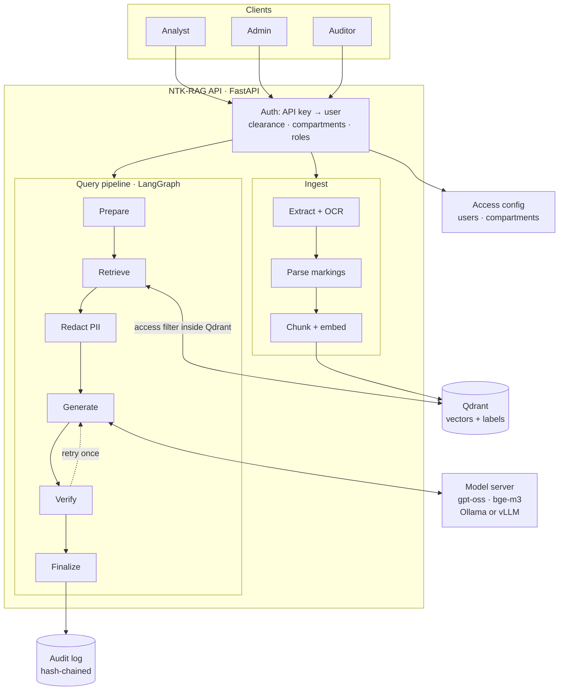
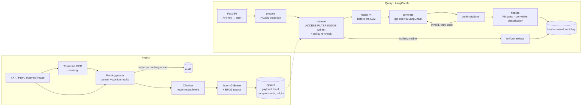

# NTK-RAG — need-to-know retrieval-augmented generation

[](https://github.com/Alegzandra/Need-To-Know-RAG/actions/workflows/ci.yml)


A secure, multilingual (Romanian/English) document-intelligence service. Analysts ask questions in
natural language; the system answers **only from the documents each analyst is cleared to see**,
cites its sources, redacts personal data, classifies its own answer, and writes every action to a
tamper-evident audit log. It runs fully on-premise: gpt-oss through Ollama or vLLM, Qdrant, FastAPI,
LangChain/LangGraph, Docker and Kubernetes.

**The same question, asked by different analysts:**

> *"Who is behind the drone flights near substation S-17 and the Port of Calvara?"*

| Analyst | Access | What the system does |
|---|---|---|
| **elena** | SECRET + ORION compartment | Answers from the ORION assessment (operator group VARTA); answer marked **SECRET** |
| **sorin** | SECRET, *not* read into ORION | Never sees ORION; answers from incident reports only (need-to-know beats clearance) |
| **mihai** | CONFIDENTIAL | Answers from the incident report, port assessment and public advisory |
| **ana** | RESTRICTED | Sees only the unclassified and restricted *paragraphs* of the port assessment |
| **klaus** | CONFIDENTIAL, German NATO liaison | Sees only documents marked REL TO NATO; national-only reports are invisible |

## Architecture

### System overview



### Query and ingest flow (detailed)



| Layer | Choice |
|---|---|
| LLM | `gpt-oss:20b`. Ollama on a laptop; **vLLM** (OpenAI-compatible API) on GPU servers. Switched with one environment variable |
| Orchestration | **LangGraph** state machine; **LangChain** prompt → model → parser chain; LangChain-compatible retriever |
| Retrieval | **Qdrant** hybrid search: dense `bge-m3` (multilingual) + sparse BM25 with Qdrant's IDF modifier, fused with RRF |
| API | **FastAPI** with API-key auth, role-based endpoints, Pydantic schemas |
| Deploy | Dockerfile (non-root), docker-compose (Qdrant + Ollama, or vLLM on GPU), **Helm chart** (read-only root FS, dropped capabilities, probes) |

## Threat model → controls → tests

| Threat | Control | Verified by |
|---|---|---|
| User retrieves text above their clearance / outside need-to-know / not releasable to them | Mandatory access filter evaluated **inside Qdrant** on every prefetch (dense and sparse) and the fused query | `test_zero_leakage_against_independent_oracle`, `test_qdrant_store_zero_leakage` |
| Vector-DB filter misconfigured | Every hit is **re-checked** against the policy in Python; violations are dropped and logged as `security_violation_blocked` | `test_defence_in_depth_when_store_filter_is_broken` |
| Filter and policy drift apart | Exhaustive equivalence test over every level × compartment × releasability combination | `test_access_filter_agrees_with_policy_exhaustively` |
| A mixed-classification document leaks high paragraphs | Portion markings parsed per paragraph; chunks **never mix levels**; portions above the banner are rejected | `test_chunks_never_mix_portion_levels`, `test_partial_document_visibility` |
| The LLM repeats something it shouldn't | Secrets never reach the prompt. Tested with a **worst-case "LLM" that echoes all its context**: 0 leaks | `test_worst_case_llm_cannot_leak_canaries_or_pii` |
| Inferring that a secret document *exists* | Identical response for "doesn't exist" and "exists but not for you"; forbidden chunks never take top-k slots | `test_uniform_refusal_does_not_reveal_existence`, `test_forbidden_chunks_do_not_consume_top_k` |
| Personal data exposure | Checksum-validated detectors (Romanian CNP, IBAN mod-97, phone, e-mail); redacted **before** the LLM and again **after** | `test_pii_redacted_for_unprivileged…`, `test_model_reintroduced_pii_is_scrubbed` |
| Hallucinated sources | Citations must match the provided `[S#]` labels; one strict retry, then refusal | `test_citation_retry_then_success`, `test_hallucinated_labels_lead_to_refusal` |
| Unknown compartment silently ignored | Compartments are declared centrally; unknown ones **fail closed** at ingest | `test_unknown_compartment_fails_closed` |
| Audit tampering | SHA-256 hash chain; `/v1/audit/verify` reports the first altered record | `test_audit_chain_detects_tampering` |
| Prompt injection in documents | Sources are delimited as data; the system prompt forbids following embedded instructions | (behavioural; add red-team cases) |

## Design decisions

1. **Security lives in retrieval, not in the prompt.** You can't prompt an LLM into keeping a
   secret reliably. What the model never sees, it can't leak. That's why the leakage tests use a
   deliberately leaky fake model: if security holds even then, it doesn't depend on the LLM.
2. **The filter runs inside the vector database.** Post-filtering top-k results would let
   forbidden chunks take ranking slots: worse answers, plus a timing and existence side channel.
   Qdrant applies the payload filter before candidates are selected, in *each* prefetch of the
   hybrid query.
3. **The rules are written twice, then proven equivalent.** Once as a Qdrant filter, once as a
   Python policy. An exhaustive test proves they agree, and the runtime re-check catches
   configuration drift.
4. **Paragraph-level classification.** Real documents mix levels. Honouring portion markings
   means a RESTRICTED analyst still gets the releasable parts of a CONFIDENTIAL report, instead of
   all or nothing.
5. **Derivative classification.** Each answer is marked with the highest level among the sources
   it *cites*, so downstream handling is correct.
6. **Independent evaluation oracle.** Leakage metrics are checked against a hand-written access
   matrix and planted canary codewords (`evals/access_matrix.json`), not against the policy code.
   A policy bug can't hide behind its own tests.
7. **Multilingual by design.** `bge-m3` puts Romanian and English in one vector space, so an
   English question finds a Romanian guideline. Sparse tokens are diacritic-folded, and language
   detection relies on function words, so Romanian typed *without* diacritics works.
8. **Framework-free core, thin adapters.** The policy, redaction, audit and pipeline steps are
   plain Python. The LangGraph graph and the plain runner execute the *same* functions, and a
   test asserts they produce identical results.

## Quick start (laptop)

Requirements: Python 3.10+, [Ollama](https://ollama.com), Tesseract (`tesseract-ocr` +
`tesseract-ocr-ron`) for scanned documents. `gpt-oss:20b` needs about 16 GB of RAM/VRAM.

```bash
pip install -e ".[dev]"
ollama pull gpt-oss:20b && ollama pull bge-m3

python scripts/make_corpus.py          # fictional RO/EN corpus: TXT, PDF, scanned PNG
ntk ingest data/corpus                 # parses markings; embedded Qdrant on disk, no server needed
ntk users
ntk ask --user elena "Who is behind the drone flights near substation S-17 and the Port of Calvara?"
ntk ask --user mihai "Who is behind the drone flights near substation S-17 and the Port of Calvara?"
ntk ask --user ana   "Care este numărul de telefon al agentului de pază de la S-17?"
ntk eval all
ntk audit verify
```

### API

```bash
ntk serve --port 8080      # OpenAPI docs at http://localhost:8080/docs

curl -s localhost:8080/v1/query -H 'X-API-Key: demo-klaus' -H 'Content-Type: application/json' \
     -d '{"question": "Cum a fost compromis operatorul de apă Apa Nord?"}'
```

| Endpoint | Role | Purpose |
|---|---|---|
| `POST /v1/query` | analyst | Answer + citations + derivative classification + redaction count |
| `POST /v1/documents` | admin | Ingest a base64 file; marking errors → 422 and an audit record |
| `GET /v1/audit`, `GET /v1/audit/verify` | auditor | Read the audit log / verify the hash chain |
| `GET /v1/me`, `GET /health` | any / public | Caller's access profile / liveness |

Demo API keys are `demo-<user>` (e.g. `demo-elena`). Only their SHA-256 hashes are stored in
`config/users.yaml`. Create real keys with `ntk hash-key <key>`.

### Containers and Kubernetes

```bash
docker compose up -d --build && docker compose --profile setup run --rm ollama-pull   # laptop / single server
docker compose --profile vllm up -d                                                  # GPU server: vLLM serves gpt-oss
helm install ntk deploy/helm/ntk-rag --set-file security.usersYaml=config/users.yaml
```

The Helm chart runs as non-root with a read-only root filesystem and all capabilities dropped. The
security config (users, compartments) comes from a Secret and a ConfigMap, never from the image.
Qdrant and vLLM are deployed with their own charts and referenced by URL.

## Evaluation

```bash
ntk eval retrieval     # recall@k, MRR, leaked chunks — embeddings only, no LLM
ntk eval generation    # canary leaks, PII leaks, refusal accuracy, citation validity, content hits
```

8 questions × 5 analysts = 40 user–question pairs per run, in Romanian and English. Includes
cross-lingual retrieval, partial-document visibility, a secret document nobody may see (existence
test), and PII-bearing questions.

Results with the offline fakes (CI): **0 leaked chunks, 0 canary leaks, 0 PII leaks**, refusal
accuracy 1.0, recall@6 = 1.0. The fakes prove the security invariants; quality numbers need the
real models.

<!-- Run on your machine and fill in. Report real numbers only. -->
| Config | recall@6 | MRR | Leaks (chunks / canaries / PII) | Refusal acc. | Citation valid | Content hits | p50 latency |
|---|---|---|---|---|---|---|---|
| gpt-oss:20b · low · bge-m3 · Qdrant | _run me_ | | | | | | |
| gpt-oss:20b · medium | _run me_ | | | | | | |

## Tests

```bash
pytest -q -rs
```

36 tests: security core, ingestion and OCR, retrieval, the pipeline and evals with fake models,
plus integration tests for LangChain, LangGraph, Qdrant (in-memory mode) and FastAPI. Integration
tests skip when a library isn't installed. CI installs everything, runs all of them, and also runs
`helm lint`, `helm template` and `docker build`.

## Project layout

```
ntk/
  security/   markings.py (banners, portion marks) · policy.py (users, access rules, filter)
              pii.py (CNP/IBAN/phone/e-mail) · audit.py (hash chain)
  ingest/     loaders.py (TXT/PDF/OCR, level-safe chunking)
  retrieval/  stores.py (in-memory + Qdrant hybrid) · secure.py (filtered search + re-check)
              langchain_retriever.py (LangChain BaseRetriever adapter)
  pipeline/   steps.py (nodes + routing) · graph.py (LangGraph) · llm.py (LangChain, Ollama/vLLM)
  api/app.py  FastAPI service · services.py composition root · cli.py · evals/runner.py
config/       users.yaml (hashed keys) · compartments.yaml
evals/        cases.json · access_matrix.json (independent oracle)
deploy/helm/  Kubernetes chart
```

## Roadmap

See **[ROADMAP.md](ROADMAP.md)** for the vision, personas, success metrics and the Now / Next / Later plan.
In short: **v0.2** real-model baselines, single sign-on and prompt-injection defences;
**v0.3** central audit sink, vLLM benchmarks and observability; **later** a web UI and GraphRAG.

## Note

All documents, organisations, places, codewords, people, personal numeric codes, IBANs and phone
numbers in the demo corpus are **fictional**. The marking scheme is simplified for demonstration
and doesn't represent any real national or NATO handling rules.

## License

MIT
